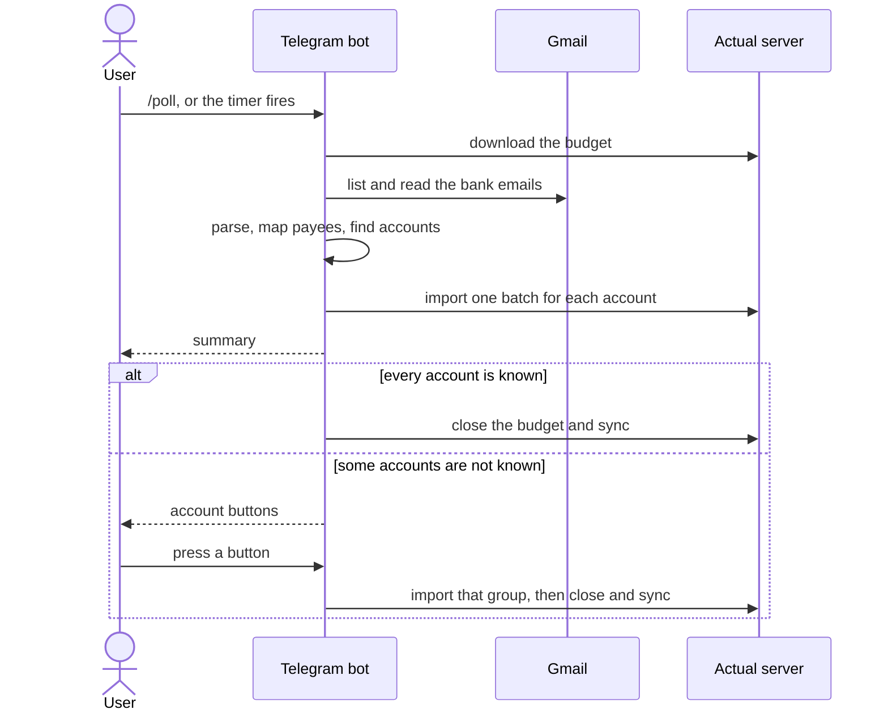

# actualbudget-composer

This tool reads bank notification emails from Gmail and imports the transactions into [Actual Budget](https://actualbudget.org). It supports two Vietnamese senders: Cake by VPBank and VPBank Online.

You use it through a **Telegram bot**. The bot imports on a timer and on `/poll`, and it replies with a summary. It uses Telegram long polling and opens no port.

`CONTRIBUTING.md` has the rules for a code change. `AGENTS.md` has the file map and the details for coding agents.

## How it works

The bot reads the bank emails, parses each one with CSS selectors from `rules.json` in `RULES_DIR`, and imports one batch for each account. A second import of the same email updates the transaction and does not add a copy.



## Setup

You need Node 26 or later and a running Actual Budget server. Keep your rules in a private folder or repo. They hold your account IDs and real emails.

1. Make the config folder. Start from the files in `examples/`, and set your own Actual account IDs in `rules.json`:

   ```
   my-config/
     package.json
     rules.json
     payees.json
     fixtures/        <name>.html + <name>.expected.json
     .env             RULES_DIR=. and the values from .env.example
   ```

2. Install the engine and add scripts to `package.json`:

   ```sh
   npm install --save-exact actualbudget-composer
   ```

   ```json
   "scripts": {
     "test": "actualbudget-composer check-rules .",
     "update": "actualbudget-composer check-rules . --update",
     "bot": "node --env-file=.env node_modules/actualbudget-composer/bin/actualbudget-composer.js bot",
     "poll": "node --env-file=.env node_modules/actualbudget-composer/bin/actualbudget-composer.js poll",
     "auth:gmail": "node --env-file=.env node_modules/actualbudget-composer/bin/actualbudget-composer.js auth-gmail",
     "inspect:mail": "node --env-file=.env node_modules/actualbudget-composer/bin/actualbudget-composer.js inspect-mail"
   }
   ```

3. Get a Gmail refresh token with `npm run auth:gmail`. Put it in `.env` as `GMAIL_REFRESH_TOKEN`.
4. Test with one poll. Set `POLL_DRY_RUN=true` to see the result without an import: `npm run poll`.
5. Start the bot with `npm run bot`.

## Deploy

Build an image in your config repo. Use `node:26-alpine`, run `npm ci --omit=dev`, copy `rules.json` and `payees.json`, and set `RULES_DIR`. Run the `bot` subcommand. Keep the budget in a volume at `ACTUAL_BUDGET_DATA_DIR`.

The `healthcheck` subcommand fails when the bot has no successful Telegram poll for 5 minutes. Use it as the container health check.

## Development

The `./mill` launcher downloads Mill and a JDK on its first run.

```sh
npm run build   # link dist/main.js
npm test        # unit tests, and check-rules over examples/
npm run lint    # scalafmt check
RULES_DIR=examples POLL_DRY_RUN=true npm run poll
```

To test an engine change against your own config, run `npm run check-rules -- ../my-config`.

## Telegram bot

The bot answers only the chat in `TELEGRAM_ALLOWED_CHAT_ID`.

| Command            | Action                                                                                                 |
| ------------------ | ------------------------------------------------------------------------------------------------------ |
| `/poll [days]`     | Import new transactions and reply with a summary.                                                      |
| `/status`          | Show the transactions that wait for an account.                                                        |
| `/cancel`          | Drop the transactions that wait for an account.                                                        |
| `/cron [interval]` | Show or set the poll interval, like `6h` or `1d`, up to `7d`. The bot keeps the value after a restart. |
| `/auth [url]`      | Rotate the Gmail refresh token without a restart. See below.                                           |

The summary shows the counts, then one line for each transaction. A scheduled poll sends a message only when something changed or failed.

| Tag   | Meaning                                   |
| ----- | ----------------------------------------- |
| `[N]` | New transaction.                          |
| `[U]` | Updates a transaction in the budget.      |
| `[=]` | The transaction is already in the budget. |

Some emails do not show the account. For these, the bot shows account buttons. Press a button to import that group. After 15 minutes, the bot drops the open picks.

The bot has no review step. Each write goes to the server at once.

To rotate the Gmail token:

1. Send `/auth`. The bot replies with a Google consent URL.
2. Open the URL and approve access. The browser then shows an error page for `http://localhost`. This is expected.
3. Copy the full URL from the address bar. Send `/auth <that URL>`.

## Fix a failed email

The summary shows each email that no rule matches as a link to the Gmail message. It ends with a `/fix-mail <id>...` line.

1. Run `npm run inspect:mail -- <id>...` with the IDs from that line. It saves each email and its parse result to `fixtures/` in `RULES_DIR`. It also prints the text that each rule selector finds.
2. Add or change a rule in `rules.json`.
3. Run `npm run update`, review the diff of `fixtures/`, and commit it.

## Check a rules folder

`check-rules` tests a `RULES_DIR` folder. Each `fixtures/<name>.html` needs a `fixtures/<name>.expected.json` with the expected parse result.

```sh
actualbudget-composer check-rules <dir>           # fail on a mismatch, a missing file, or a rule with no fixture
actualbudget-composer check-rules <dir> --update  # rewrite each expected file from the current rules
```

After `--update`, review the change of each expected file with `git diff`.

## Configuration

See `.env.example` for the full list.

| Variable                                                    | Purpose                                                                          |
| ----------------------------------------------------------- | -------------------------------------------------------------------------------- |
| `RULES_DIR`                                                 | Folder with `rules.json`, `payees.json`, and `fixtures/`. Required.              |
| `ACTUAL_BUDGET_URL` / `PASSWORD` / `SYNC_ID` / `ACCOUNT_ID` | Actual server connection and fallback import account.                            |
| `ACTUAL_BUDGET_DATA_DIR`                                    | Local folder for the downloaded budget. Default `./data`.                        |
| `GMAIL_CLIENT_ID` / `CLIENT_SECRET` / `REFRESH_TOKEN`       | Gmail OAuth with the read-only scope.                                            |
| `GMAIL_REDIRECT_URI`                                        | OAuth redirect URI. Default `http://localhost`.                                  |
| `POLL_LOOKBACK_DAYS`                                        | Search window in days. Default 3 for the bot, 1 for `npm run poll`.              |
| `POLL_INTERVAL`                                             | Time between scheduled polls, in `h` or `d`. Default `6h`. `/cron` overrides it. |
| `POLL_DRY_RUN`                                              | Log the parsed transactions and skip the import.                                 |
| `POLL_DEBUG`                                                | Log debug lines.                                                                 |
| `TELEGRAM_BOT_TOKEN` / `TELEGRAM_ALLOWED_CHAT_ID`           | Bot token and the one chat that the bot answers.                                 |
