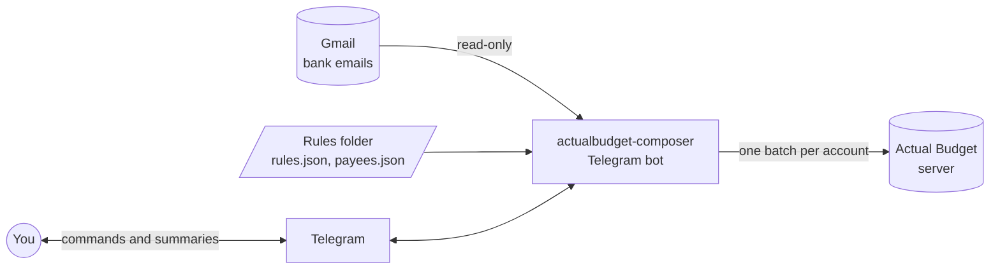
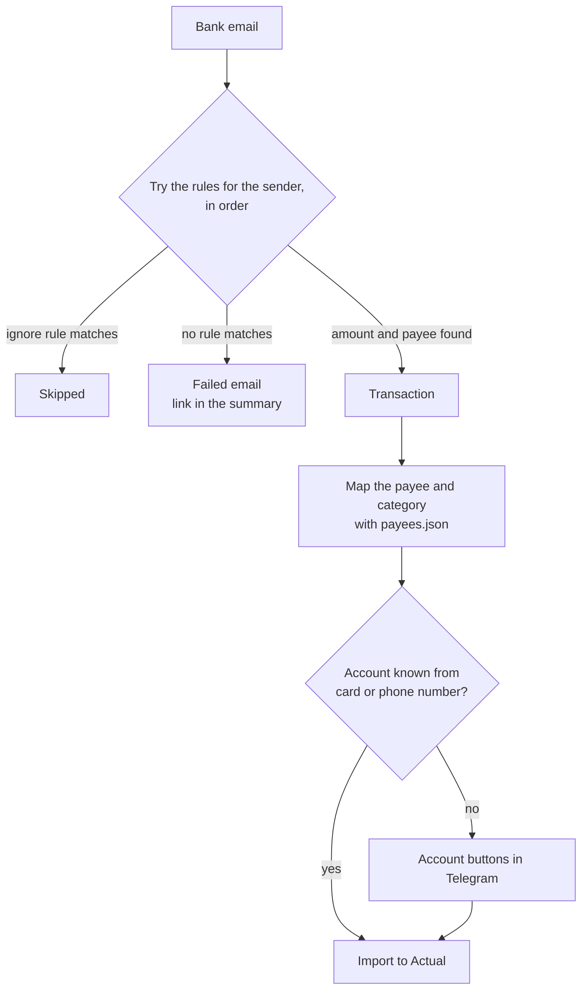
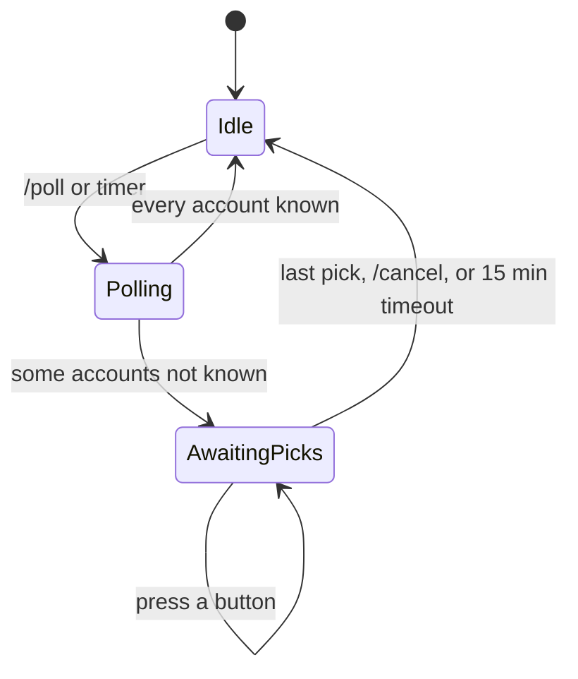
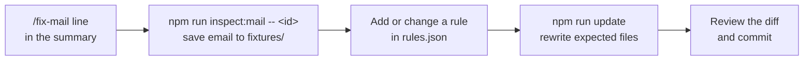

# actualbudget-composer

This tool imports bank transactions into [Actual Budget](https://actualbudget.org). It reads bank notification emails in Gmail and parses each email with your rules. It supports two Vietnamese senders: Cake by VPBank and VPBank Online.

You use it through a Telegram bot. The bot imports on a timer and on `/poll`. It uses Telegram long polling and opens no port.

## Overview



| Part          | Role                                                                                 |
| ------------- | ------------------------------------------------------------------------------------ |
| Gmail         | Holds the bank emails. The tool has read-only access.                                |
| Rules folder  | Your private folder. It holds the CSS selectors, the payee map, and the test emails. |
| Telegram bot  | Runs each poll, imports the transactions, and sends you a summary.                   |
| Actual Budget | Stores the transactions.                                                             |

## How an email becomes a transaction



Each transaction gets the bank reference as its ID. A second import of the same email updates the transaction and does not add a copy.

## Poll states



The bot opens the budget at the start of a poll. It closes the budget and syncs in the `Idle` state. A new poll waits until the bot is `Idle`.

## Setup

You need Node 26 or later and a running Actual Budget server. Keep your rules in a private folder. They hold your account IDs and real emails.

1. Make the config folder. Start from the files in `examples/`. Set your own Actual account IDs in `rules.json`.

   ```
   my-config/
     package.json
     rules.json
     payees.json
     fixtures/        <name>.html + <name>.expected.json
     .env             RULES_DIR=. and the values from .env.example
   ```

2. Install the package and add the scripts to `package.json`.

   ```sh
   npm install --save-exact actualbudget-composer
   ```

   ```json
   "scripts": {
     "test": "actualbudget-composer check-rules .",
     "update": "actualbudget-composer check-rules . --update",
     "bot": "node --env-file=.env node_modules/actualbudget-composer/bin/actualbudget-composer.js bot",
     "poll": "node --env-file=.env node_modules/actualbudget-composer/bin/actualbudget-composer.js poll",
     "auth:gmail": "node --env-file=.env node_modules/actualbudget-composer/bin/actualbudget-composer.js auth-gmail",
     "inspect:mail": "node --env-file=.env node_modules/actualbudget-composer/bin/actualbudget-composer.js inspect-mail"
   }
   ```

3. Run `npm run auth:gmail`. Put the token in `.env` as `GMAIL_REFRESH_TOKEN`.
4. Run `POLL_DRY_RUN=true npm run poll`. This shows the result and imports nothing.
5. Run `npm run bot`.

## Telegram bot

The bot answers only the chat in `TELEGRAM_ALLOWED_CHAT_ID`. Each write goes to the server at once. There is no review step.

| Command            | Action                                                                            |
| ------------------ | --------------------------------------------------------------------------------- |
| `/poll [days]`     | Import new transactions and reply with a summary.                                 |
| `/status`          | Show the transactions that wait for an account.                                   |
| `/cancel`          | Drop the transactions that wait for an account.                                   |
| `/cron [expr \| off]` | Show, set, or turn off the poll crontab, like `0 */6 * * *`, in UTC+7. The value persists. With no value, the scheduled poll is off. The reply shows the next poll time. |
| `/auth [url]`      | Rotate the Gmail refresh token without a restart.                                 |

The summary shows the counts and one line for each transaction. A scheduled poll sends a message only when something changed or failed.

| Tag   | Meaning                                   |
| ----- | ----------------------------------------- |
| `[N]` | New transaction.                          |
| `[U]` | Updates a transaction in the budget.      |
| `[=]` | The transaction is already in the budget. |

To rotate the Gmail token:

1. Send `/auth`. The bot replies with a Google consent URL.
2. Open the URL and approve access. The browser shows an error page for `http://localhost`. This is expected.
3. Copy the full URL from the address bar. Send `/auth <that URL>`.

## Fix a failed email

The summary ends with a `/fix-mail <id>...` line for the emails that no rule matches.



`npm test` checks each `fixtures/<name>.html` against its `<name>.expected.json`. It fails on a mismatch, a missing file, or a rule with no fixture.

## Development

The `./mill` launcher downloads Mill and a JDK on its first run.

```sh
npm run build   # link dist/main.js
npm test        # unit tests, and check-rules over examples/
npm run lint    # scalafmt check
RULES_DIR=examples POLL_DRY_RUN=true npm run poll
```
